  

  
  
  
  

<h3 align="center">I build websites that bring businesses more enquiries.</h3>

  Web developer in Jaipur, building for clients across India and abroad since 2017. 
  Hotels, travel companies, real-estate firms, NGOs, and the products behind them.

 

## ⚡ Right now

- 💼 **Senior developer at [Brubyte](https://brubyte.com):** AI products (MyAIIdentity), e-commerce
  (BaseBuy) and crypto tools (Smart Exchange)
- 🌐 **Client work:** business websites, landing pages, web apps and website care
- 📝 **Writing** short "One-Minute Fix" tips from real projects at
  [fazilkhan.com/tips](https://fazilkhan.com/tips)
- 🎥 **Coming soon:** a Hinglish YouTube channel where I build real websites step by step
- 🎓 **Helping** students and beginners find their path into software

## 🧰 What I work with

<table>
  <tr>
    <td width="150"><b>Frontend</b></td>
    <td> Next.js · React · TypeScript · Tailwind · animations · Figma to code</td>
  </tr>
  <tr>
    <td><b>Backend</b></td>
    <td> Node.js · NestJS · Express · Laravel · PHP · Python</td>
  </tr>
  <tr>
    <td><b>Databases</b></td>
    <td> MySQL · PostgreSQL · MongoDB · Redis</td>
  </tr>
  <tr>
    <td><b>WordPress</b></td>
    <td> Elementor · custom themes · WooCommerce · plugin development and modifications</td>
  </tr>
  <tr>
    <td><b>Cloud &amp; DevOps</b></td>
    <td> AWS · Cloudflare · Linux · NGINX · Docker · CI/CD</td>
  </tr>
  <tr>
    <td><b>Web3</b></td>
    <td> Smart contracts · wallets and multichain apps · MPC / TSS signing</td>
  </tr>
  <tr>
    <td><b>AI</b></td>
    <td>Claude API and Claude Code · agents and automation · Whisper · ffmpeg · OSINT tools · image processing</td>
  </tr>
  <tr>
    <td><b>Also</b></td>
    <td>Chrome extensions · headless CMS and static sites</td>
  </tr>
</table>

## 🤝 Let's work together

Need a website, a fix on the one you have, or a second pair of eyes on a project?
**[Plan your website in 2 minutes](https://fazilkhan.com/#plan)** or say hi on
[LinkedIn](https://www.linkedin.com/in/kfazil).

Made in Jaipur · <a href="https://fazilkhan.com">fazilkhan.com</a>

